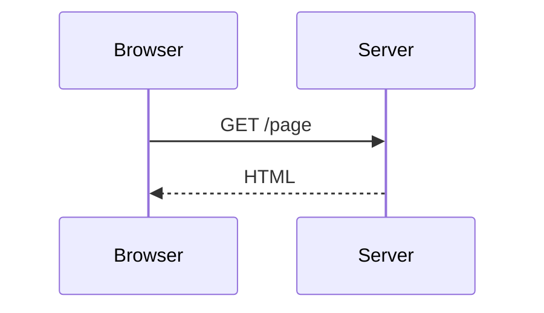

# Elemen

个人博客。记录开发中遇到的问题、读过的代码和做过的练习。

## 内容

- **文章**：Frontend、Backend、AI、Algorithm、Web3，以及零散笔记。
- **代码练习**：手写题与实践记录，保留思路和源码。

## 技术栈

Next.js 16 · React 19 · TypeScript · Tailwind CSS 4 · MDX

文章搜索使用 Fuse.js，代码高亮使用 Shiki。

## 本地运行

```bash
git clone --recurse-submodules https://github.com/404ll/Elemen-blog.git
cd Elemen-blog
npm install
npm run dev
```

新建文章：`npm run new-post`。

## Mermaid 图表

MDX 文章和 CMS 导入的 Markdown 都可以直接使用 Mermaid 代码块：

````md

````

图表在浏览器中按需渲染，默认适配正文宽度；点击 `Actual size` 可按原尺寸横向滚动查看。`Mermaid source` 保留源码，语法错误不会阻断正文。普通代码块继续使用原有语法高亮。

## License

MIT
