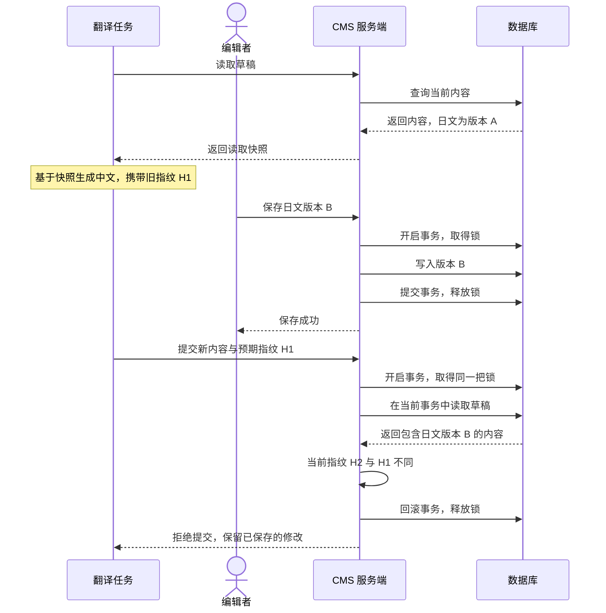

乐观并发控制在提交修改时验证读取依据，防止旧数据覆盖已经保存的新修改。它允许多个参与者同时读取、编辑或生成内容，直到写入阶段，才判断某次修改是否仍然有效。

对于需要调用外部模型的内容生成任务，可以把耗时计算放在事务之外，提交时再用一个短事务完成版本检查和保存。这套设计的核心是：**提交必须携带读取依据，检查与写入必须在一个原子保护范围内完成。**

下面沿着一次多语言草稿更新展开。代码使用简化的 TypeScript 数据结构和数据库接口说明机制，实际接入时需要适配 CMS 的草稿存储与事务 API。

## 读取内容并在事务外生成结果

一份草稿把所有语言存放在同一个 `content` JSON 中。翻译任务读取英文，生成中文，再提交合并后的内容。

```ts
const snapshot = await readDraft(id);
const translated = await translate(snapshot.content.locales.en);

const nextContent = {
  locales: {
    ...snapshot.content.locales,
    zh: translated,
  },
};
```

这里存在两个时间跨度：`snapshot` 是读取时的页面状态，`nextContent` 是翻译完成后准备保存的状态。翻译期间，编辑者仍然可以修改同一份草稿。

如果日文在此期间从版本 A 改成版本 B，而翻译任务直接提交整份 `nextContent`，它携带的旧日文就可能覆盖版本 B：

```text
翻译任务读取：旧中文 + 日文版本 A
编辑者保存：旧中文 + 日文版本 B
翻译任务提交：新中文 + 日文版本 A
```

这叫丢失更新（Lost Update）。两个保存请求都可能成功，但其中一次修改丢失了。它属于共享可变状态的并发控制问题，在表单、配置管理和后台计算结果回写中都有同样的结构。

这里采用的业务规则是：生成结果的依据发生变化时，拒绝本次提交，保留已保存的修改。翻译任务可以重新处理，人工修改不能被静默抹掉。

## 给提交附上内容指纹

调用方根据读取到的旧内容计算指纹，把它与新内容一起提交。

```ts
const expectedFingerprint = fingerprint(snapshot.content);

await submitDraft({
  id,
  expectedFingerprint,
  content: nextContent,
});
```

`expectedFingerprint` 标识本次修改所依据的内容，`nextContent` 才是想写入的新内容。两者不能混淆：如果根据新内容计算预期指纹，服务端就无法用它核对原来的读取依据。

假设旧内容的指纹是 `H1`。服务端接受提交的条件就是：当前草稿的内容指纹仍然等于 `H1`。如果其他编辑已经让指纹变成 `H2`，就拒绝这次旧提交。

HTTP 接口可以通过请求头传递这个条件：

```http
If-Match: "H1"
```

`If-Match` 是 HTTP 标准中的条件请求机制，用来避免多个客户端相互覆盖更新；预条件不成立时使用 `412 Precondition Failed`。[RFC 9110](https://www.rfc-editor.org/rfc/rfc9110.html#section-13.1.1)

指纹可以通过内容规范化后计算哈希得到。对象键顺序需要稳定，避免仅仅因为属性排列不同就得到不同指纹；数组顺序通常仍应参与比较。内容变化后又完全恢复，指纹可能回到原值，因此它表达的是内容是否相同。业务如果需要识别每一次修改，应考虑由所有相关写入共同维护递增版本号。

这一阶段尚未锁住草稿，编辑和翻译仍可并行。乐观并发控制把冲突处理推迟到提交阶段。

## 在服务端短事务中核对并保存

版本检查必须与写入构成一个完整的保护范围。先读取、比较，再独立执行保存，中间仍然可能插入其他修改。

在现有 CMS 的保存流程中，可以使用事务级 advisory lock，把相关写入的检查与保存串行组织起来：

```sql
SELECT pg_advisory_xact_lock(hashtext('content-drafts:update'));
```

固定字符串生成共同使用的锁标识。各请求有自己的数据库事务，但会申请同一把锁。先取得锁的事务继续执行，其他申请相同锁的事务等待；当前事务提交或回滚时，锁自动释放。这是 PostgreSQL 的事务级 advisory lock 行为。[PostgreSQL 官方文档](https://www.postgresql.org/docs/current/explicit-locking.html#ADVISORY-LOCKS)

服务端应在拿到锁之后，使用当前事务读取草稿，再检查指纹。这样，等待锁期间其他事务已经提交的修改才能进入后续检查。读取可见性还要结合事务隔离级别确认，例如在 PostgreSQL 的 Read Committed 下，取得锁后发起的新查询可以读取查询开始前已提交的内容。[事务隔离文档](https://www.postgresql.org/docs/current/transaction-iso.html)

```ts
await tx.lock("content-drafts:update");

const current = await tx.readDraft(id);

if (fingerprint(current.content) !== expectedFingerprint) {
  throw new Error("Draft changed; reload and retry");
}

await tx.saveDraft(id, nextContent);
```

顺序是取得锁、读取、核对、保存。先读取再等待锁，会让请求拿到锁后继续使用等待之前的旧数据，甚至让旧指纹比较错误地通过。

内容指纹在这里承担乐观并发检查，事务锁保护提交阶段的临界区。只让写入排队，不能识别旧提交；只在应用里比较一次指纹，也不能消除检查到写入之间的空隙。

编辑者先保存、翻译任务随后提交时，完整执行顺序如下：



如果指纹匹配，服务端继续保存，并在提交事务后释放锁。锁只覆盖最后这段数据库操作，翻译模型调用留在事务之外，避免其他写入在整个生成期间等待。

## 让事务上下文贯穿读取和写入

把提交阶段整理成一个函数，可以得到下面的骨架。`DraftDatabase` 和 `DraftTransaction` 是教学接口：适配层需要确保 `tx` 的所有操作使用同一个数据库事务，回调成功后提交，失败则回滚。

```ts
type DraftContent = {
  locales: Record<string, {
    title: string;
    description: string;
  }>;
};

type DraftTransaction = {
  lock: (key: string) => Promise<void>;
  readDraft: (id: string) => Promise<{ content: DraftContent }>;
  saveDraft: (id: string, content: DraftContent) => Promise<void>;
};

type DraftDatabase = {
  transaction: (work: (tx: DraftTransaction) => Promise<void>) => Promise<void>;
};

async function saveDraftIfUnchanged(
  db: DraftDatabase,
  id: string,
  expectedFingerprint: string,
  nextContent: DraftContent,
  fingerprint: (content: DraftContent) => string,
): Promise<void> {
  await db.transaction(async (tx) => {
    await tx.lock("content-drafts:update");

    const current = await tx.readDraft(id);

    if (fingerprint(current.content) !== expectedFingerprint) {
      throw new Error("Draft changed; reload and retry");
    }

    await tx.saveDraft(id, nextContent);
  });
}
```

这里最重要的是，`lock`、`readDraft` 和 `saveDraft` 都通过同一个 `tx` 执行。仅仅把检查和保存写进同一个函数，无法建立这个保证。

如果只在事务内检查，事务结束后再保存，检查通过到保存开始之间又会出现空隙：

```ts
await db.transaction(async (tx) => {
  await acquireLock(tx);
  await checkFingerprint(tx);
});

await saveDraft();
```

执行到最后一行时，检查所属的事务已经提交，锁也已经释放。保存需要移入前面的事务，并实际使用它的连接或上下文。

```ts
await db.transaction(async (tx) => {
  await acquireLock(tx);
  await checkFingerprint(tx);
  await saveDraft(tx);
});
```

代码的位置与事务归属还需要分开确认。假定 `saveDraft()` 不传 `tx` 时会使用独立连接提交，即使它位于回调里面，也不会参与外层事务。独立保存成功后，外层事务再回滚，也撤销不了那次保存。有些库会隐式传播事务上下文，是否必须显式传参应以实际 API 为准。

采用保存前钩子的 CMS 也遵守同一个边界：框架先建立事务，钩子取得当前请求的事务并加锁，在同一事务中检查草稿，然后把控制权交还框架继续写入。钩子返回代表检查完成；只有外层事务结束，事务级锁才释放。

## 在冲突边界内复用这套机制

这套方案适合允许并行编辑、又不能接受旧结果静默覆盖新状态的业务。它的代价是提交可能被拒绝，调用方需要提供冲突后的处理路径。冲突后应重新读取并判断结果是否还适用；原文已变时通常需要重新生成，目标内容被人工修改时可能需要人工确认。直接换用新指纹，再原样提交旧结果，会失去版本检查的意义。

示例使用整份草稿的内容指纹，因此任何语言变化都会让旧提交失效。这种做法保守、容易验证，但无关修改也会造成冲突。更细的实现可以在保存前重新读取，仅合并没有冲突的语言，同时校验生成结果所依赖的原文和目标语言；从重新读取到最终写入之间，仍然需要条件提交。

锁的粒度与版本的粒度可以分别设计。示例使用集合级锁，意味着不同页面的提交也会等待。按页面分配锁标识可以减少无关等待，但所有相关写入入口必须采用一致的规则。Advisory lock 依赖共同遵守，绕过加锁逻辑的写入不会自动受到保护；不携带指纹的编辑请求也只参与排队，无法获得同样的过时提交检测。

如果数据层可以直接完成原子的版本条件更新，也可以不额外申请显式 advisory lock。例如使用递增版本的简化表结构时，可以把检查和修改交给一条 SQL：

```sql
UPDATE drafts
SET content = $1,
    revision = revision + 1
WHERE id = $2
  AND revision = $3;
```

`$1`、`$2`、`$3` 分别是新内容、目标 ID 和预期版本。在目标记录存在且写入权限成立的前提下，条件更新未命中表示版本不匹配；所有相关写入必须正确维护 `revision`。这是同一种乐观并发控制的另一种实现方式。具体选择取决于框架是否允许安全地操作真实草稿版本，而不能绕开 CMS 的版本、权限与保存逻辑。

Kubernetes 的资源更新使用 `resourceVersion` 检测旧提交，版本过时会返回 `409 Conflict`。它与 HTTP `If-Match` 的协议细节不同，但共同表达了提交依据必须仍然成立这一规则。[Kubernetes 官方文档](https://kubernetes.io/docs/reference/using-api/api-concepts/#updates-to-existing-resources)

将这套能力迁移到配置编辑、异步计算或 AI 内容生成时，可以继续沿着同一条链路检查实现：读取依据随结果一起提交，在权威写入位置完成原子校验，所有数据库操作归属同一个保护范围，冲突结果交给明确的重算或人工处理流程。

配套代码：[用内容指纹和短事务保护草稿更新](/practice/work/draft-concurrency-guard)。
