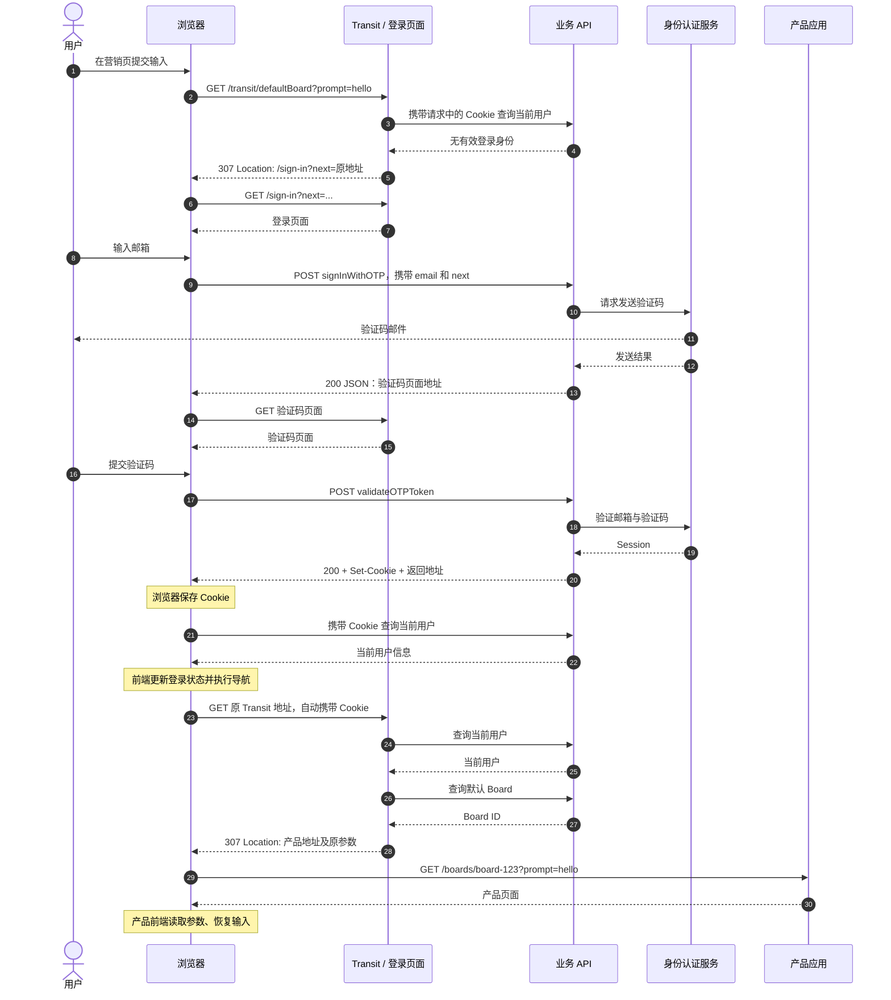

## 摘要

营销页与产品页分离部署时，用户从营销页进入产品，通常需要完成三个步骤：将用户输入传递到产品入口；确认用户身份，必要时完成登录；登录后返回原入口，恢复输入并继续操作。

这条链路涉及页面导航、请求分发、身份认证和状态恢复。**它由多次独立的 HTTP 请求组成，不同请求可以分别使用 GET 或 POST。**

以下以一个 Transit 跳转入口为例，说明这几个机制如何配合。接口和报文保留关键结构，省略与主流程无关的字段；登录流程以已有账户的邮箱验证码登录为例，不展开新用户初始化、第三方 OAuth 和失败重试分支。

关于 Session、Token 与 Cookie 的基本关系，可以先阅读[鉴权系统：从身份认证到权限控制](/blog/backend/authentication-and-authorization)。

## 1. Transit：进入产品前的跳转入口

用户在营销页输入 Prompt，点击按钮后，前端构造目标地址：

```text
/transit/defaultBoard?prompt=hello&skillId=example
```

然后执行页面导航：

```javascript
const params = new URLSearchParams({
  prompt: 'hello',
  skillId: 'example',
});

window.location.href = `/transit/defaultBoard?${params}`;
```

浏览器因此发起 GET 请求：

```http
GET /transit/defaultBoard?prompt=hello&skillId=example HTTP/1.1
Host: example.com
```

Transit 的职责是确认用户身份、确定目标 Board，并返回跳转地址。Board 在这里表示承载用户内容的工作区容器，实际生成任务由进入产品后的业务流程处理。

这里的 Transit 是业务路由名称。它可以由一个 Route Handler 实现：接收请求、读取参数、调用后端接口，最终返回重定向响应。它本身是一个明确的请求目标，与在多个路由之前执行的 Middleware 职责不同。

## 2. 请求分发与重定向的区别

多个应用可以部署在不同位置，通过同一个域名对外提供服务。边缘路由根据请求路径选择目标应用：

```text
浏览器
  ↓
统一域名
  ↓
边缘路由按路径分发
  ├─ 营销页面 → 营销应用
  ├─ 登录与跳转入口 → 登录应用
  ├─ /api/... → 业务 API
  └─ 产品页面 → 产品应用
```

这个过程属于**请求分发**：浏览器发出的请求，由边缘服务转交给对应应用处理。

**HTTP 重定向**则发生在响应阶段。例如：

```http
HTTP/1.1 307 Temporary Redirect
Location: /sign-in?next=...
```

浏览器收到这个响应后，会向 `Location` 指定的地址重新发起请求。307 会保留请求方法；原请求是 GET，后续请求仍然是 GET。

因此，边缘分发和浏览器重定向是两个不同的过程：

| 机制 | 执行方 | 作用 |
| --- | --- | --- |
| 请求分发 | 边缘服务 | 将请求交给对应应用 |
| HTTP 重定向 | 浏览器 | 根据响应中的地址发起后续请求 |

仓库是否采用 monorepo，描述的是代码如何组织；应用部署在哪里、请求如何进入应用，描述的是运行时架构。两者需要分别理解。

## 3. 已登录：恢复身份并确定目标页面

浏览器访问 Transit 时，如果存在符合发送条件的 Cookie，就会自动携带：

```http
GET /transit/defaultBoard?prompt=hello HTTP/1.1
Cookie: auth_session=<credential>
```

Transit 将收到的身份凭证带给业务 API，由后端完成验证并查询当前用户。确认身份后，再查询用户的默认 Board：

```text
请求携带 Cookie
        ↓
后端验证身份凭证
        ↓
确认当前用户
        ↓
查询默认 Board
        ↓
构造产品页面地址
```

Cookie 存在不代表身份有效。凭证仍然可能过期、失效或被篡改，必须经过后端验证。

取得 Board ID 后，Transit 返回重定向：

```http
HTTP/1.1 307 Temporary Redirect
Location: /boards/board-123?prompt=hello
```

浏览器随后请求产品页面。页面加载后，产品前端读取参数，恢复输入。产品的业务 API 仍然需要独立检查身份和资源访问权限，入口处的检查不能代替后续接口鉴权。

## 4. 未登录：通过 next 保存返回地址

如果无法确认用户身份，Transit 将用户重定向到登录页，同时保存原地址：

```text
原地址：
/transit/defaultBoard?prompt=hello

登录地址：
/sign-in?next=%2Ftransit%2FdefaultBoard%3Fprompt%3Dhello
```

`next` 的内容是编码后的完整相对地址，包含路径和查询参数。

这里需要保存返回地址，是因为第一次 Transit 请求已经结束。服务端不会保留这次请求，等待用户登录后再从原来的位置继续执行。

登录成功以后，浏览器会再次访问 `next` 指定的地址。**这是一次新的 Transit 请求，路由处理逻辑会重新执行。**

由于 `next` 来自客户端输入，实际使用前还需要校验目标地址，限制可返回的范围。

## 5. 登录成功：写入 Cookie，再返回 Transit

邮箱验证码登录可以拆成两次提交。第一次请求发送验证码：

```http
POST /api/v1/auth/signInWithOTP
Content-Type: application/json

{
  "email": "user@example.com",
  "next": "/transit/defaultBoard?prompt=hello"
}
```

发送成功后，前端进入验证码页面。第二次请求提交验证码，身份认证成功后，接口层通过响应头写入登录凭证，并在响应体中返回后续地址：

```http
HTTP/1.1 200 OK
Set-Cookie: auth_session=<serialized-session>; Path=/; Secure; SameSite=Lax
Content-Type: application/json

{
  "redirect": "/transit/defaultBoard?prompt=hello"
}
```

这里的 Cookie 名称和属性用于示意，不代表具体项目配置。Cookie 可以保存 Session ID，也可以保存 Token 或序列化的认证 Session，具体取决于采用的认证方案。`HttpOnly`、`Secure`、`SameSite` 等属性由响应中的 `Set-Cookie` 设置；后续请求的 `Cookie` 头主要携带名称和值。

浏览器根据 `Set-Cookie` 保存 Cookie。前端代码查询当前用户、更新界面登录状态，再读取 `redirect` 执行后续导航。

需要区分两种响应：

| 响应 | 后续行为 |
| --- | --- |
| `307` + `Location` | 浏览器按 HTTP 重定向机制继续请求 |
| `200` + JSON 中的 `redirect` | 前端代码读取字段并执行导航 |

JSON 中的 `redirect` 只是应用约定的字段，本身不会触发浏览器跳转。`fetch()` 请求即使跟随了 HTTP 重定向，也不会因此把当前页面导航到目标地址。

## 6. 完整请求时序

下面省略边缘路由的重复分发过程，集中展示请求与响应关系。图中的产品应用负责返回页面；读取参数、恢复输入等逻辑运行在浏览器中的产品前端。



登录前后的两次 Transit 请求具有相同的目标地址，但携带的身份凭证不同，因此会进入不同的处理分支。如果用户一开始就已经登录，可以直接进入查询 Board 和跳转产品的分支。

## 7. 为什么 Transit 使用 GET，登录使用 POST？

HTTP 方法描述的是单次请求。一个业务流程可以组合多种方法：

| 请求 | 方法 | 目的 |
| --- | --- | --- |
| 访问 Transit | GET | 确定下一步访问地址 |
| 加载登录页面 | GET | 获取页面 |
| 提交邮箱与验证码 | POST | 提交认证信息 |
| 返回 Transit | GET | 重新检查身份并确定目标 |
| 访问产品页面 | GET | 加载产品界面 |

Transit 使用 GET，便于通过普通链接和浏览器导航访问，也便于将目标地址保存在 `next` 中。这个入口承担导航和查询职责；真正创建任务、提交生成等操作由后续业务接口处理。

如果改为 POST，并将 Prompt 放入请求体，登录后的返回流程就需要另外保存和恢复请求体。原因是 `next` 保存的是一个地址，后续访问这个地址时，不会自动重新提交先前 POST 请求中的数据。

这里讨论的是跨越整个登录流程后的返回。单次 307 重定向本身会保留方法和请求体，但这不能替代登录过程中业务输入的持久化与恢复。

POST 也可以实现这条链路，但需要明确设计数据如何跨越登录过程。并不是“POST 不能跳转”，也不是“POST 一定只能把参数放进请求体”。

## 8. 长 Prompt 如何跨页面传递？

当 Prompt 较长时，将全部内容放入 URL 会受到浏览器、代理和服务端等环节的长度限制。URL 中的内容还可能进入浏览历史和访问日志。

一种处理方式是将较长内容暂存在浏览器存储中：

```text
营销页保存草稿
        ↓
导航至 Transit
        ↓
必要时完成登录
        ↓
进入产品页面
        ↓
读取草稿并恢复输入
```

采用 `localStorage` 时，有几个具体条件：

- 营销页与产品页必须同源，才能直接访问同一份存储。
- 草稿需要有有效期，避免恢复过时内容。
- 多标签页并行操作时，需要避免不同草稿互相覆盖。
- 消费完成后需要清理，避免后续重复恢复。
- 存储不可用、容量不足或草稿已过期时，需要有明确的恢复失败处理。

是否位于同一个仓库、是否部署在同一个平台，都不决定能否共享 `localStorage`。浏览器判断同源依据的是协议、主机和端口。同样，Cookie 按自身的 Domain、Path、Secure、SameSite 等规则发送，不能直接套用 `localStorage` 的同源规则。

如果页面确实跨源，或者需要跨设备恢复，也可以把草稿保存在服务端，在 URL 中只传递标识，并在读取时验证访问权限。浏览器存储解决的是前端输入的连续性，不应作为身份凭证的可信来源。

## 9. 三类状态分别解决什么问题？

这条链路中的数据可以按职责区分：

| 数据 | 回答的问题 | 使用位置 |
| --- | --- | --- |
| Cookie 中的身份凭证 | 当前请求来自谁？ | 后端身份认证 |
| `next` 返回地址 | 登录后继续访问哪里？ | 登录后的导航 |
| 查询参数或草稿 | 用户此前输入了什么？ | 产品前端恢复输入 |

分析类似流程时，可以按每一次请求记录：发起方、HTTP 方法、参数位置、响应类型，以及谁负责发起下一次请求。这样就能区分服务器内部调用、浏览器导航和前端状态恢复，而不会把整条业务流程误认为一个持续执行的请求。
